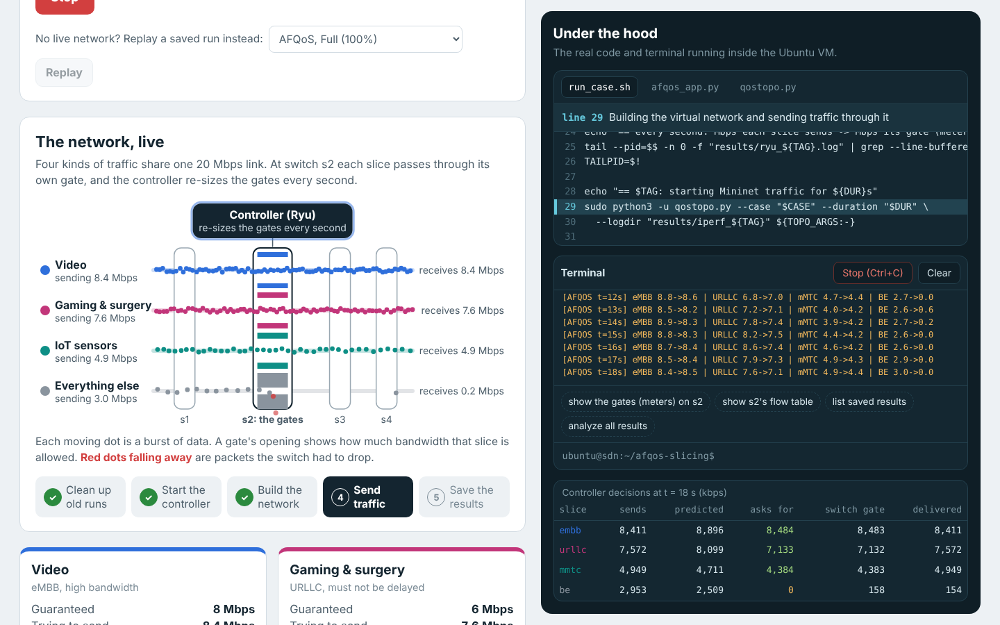
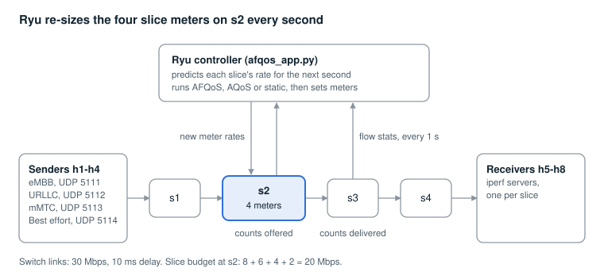

<div align="center">

# Adaptive 5G Network Slicing with SDN

**A working reproduction of *Adaptive quality of service for packet loss reduction using OpenFlow meters*, with a live web dashboard.**

[](https://doi.org/10.7717/peerj-cs.1848)
[-0E8F86)](https://doi.org/10.5281/zenodo.10184077)
[](NOTICE.md)


[Deploy the demo on Vercel](https://vercel.com/new/clone?repository-url=https://github.com/08pranav/5g-slicing)



</div>

---

## Credit where it is due

**The algorithm, the experiment and the reference results are the work of Krishneel Deo, Kaylash Chaudhary and Mansour Assaf.** This repository is a reproduction of their paper, built on their published code, plus a dashboard to watch it run.

> K. Deo, K. Chaudhary, M. Assaf (2024). *Adaptive quality of service for packet loss reduction using OpenFlow meters.* PeerJ Computer Science 10:e1848. https://doi.org/10.7717/peerj-cs.1848
>
> K. Deo (2023). *Adaptive Quality of Service using Predictive Rate Approximation using OpenFlow Meters.* Zenodo. https://doi.org/10.5281/zenodo.10184077 (CC BY 4.0)

The allocation functions and the traffic generator are kept as the authors wrote them. Every change is listed in [NOTICE.md](NOTICE.md).

## The idea in one minute

A 5G network carries very different traffic over shared capacity: video, remote surgery, sensors, everything else. Network slicing gives each type its own share. Fixed shares waste bandwidth: a slice that bursts above its limit drops packets while another slice's unused share sits idle.

Here, four slices share one congested **20 Mbps** link. An SDN controller (Ryu) watches every slice once per second, predicts what each will need next, and re-sizes each slice's bandwidth limit on the switch, so a busy slice can borrow from a quiet one without starving it.

| Slice | Paper name | Guaranteed | Traffic |
|---|---|---|---|
| eMBB, video | QoS 1 | 8 Mbps | h1 to h5, UDP 5111 |
| URLLC, gaming and remote surgery | QoS 2 | 6 Mbps | h2 to h6, UDP 5112 |
| mMTC, IoT sensors | QoS 3 | 4 Mbps | h3 to h7, UDP 5113 |
| Best effort | QoS 4 | 2 Mbps | h4 to h8, UDP 5114 |

*The paper calls the slices QoS classes 1 to 4. The eMBB, URLLC and mMTC labels are this project's mapping onto 5G slice types.*

Three sharing rules are compared:

| Rule | What it does every second |
|---|---|
| `static` | Keeps every limit at its guaranteed rate. An extra baseline added here. |
| `aqos` | The paper's baseline (Boley, Jung & Kettimuthu, 2017). Caps a quiet slice at exactly its current rate and gives the spare to busy slices. |
| `afqos` | **The paper's algorithm.** Lends spare bandwidth in proportion to each slice's need, leaves quiet slices room to grow, and takes from best effort first when every slice is over budget. |

## How it works

<div align="center">

</div>

Each slice has its own OpenFlow **meter** (a rate limiter inside the switch) on **s2**, the congestion point. Every second the controller:

1. reads each slice's byte counters from s2 (traffic *offered*) and s3 (traffic *delivered*),
2. predicts each slice's next rate with a least-squares line over the last 10 samples,
3. runs the chosen rule and writes the new meter rates to s2.

Traffic is bursty UDP from iperf: a new 2-second burst every 2 seconds, following a constant, then sine, then x² pattern with ±20% jitter, each slice phase-shifted by 60 s.

## Results

Four load levels, three rules. Per-slice throughput is bytes counted at s3 divided by bytes counted at s2 (eMBB / URLLC / mMTC / best effort, in %).

| Case | Load | Fixed slices (avg) | AQoS (avg) | AFQoS | AFQoS avg | Paper's AFQoS avg |
|---|---|---|---|---|---|---|
| 1 | 80% | 99.33 | 100.00 | 100.0 / 100.0 / 100.0 / 100.0 | **100.00** | 99.98 |
| 2 | 100% | 95.87 | 98.54 | 100.0 / 100.0 / 100.0 / 91.9 | **97.97** | 97.99 |
| 3 | 120% | 81.49 | 86.18 | 100.0 / 100.0 / 100.0 / 54.6 | **88.66** | 86.85 |
| 4 | 95%, best effort needs more | 87.82 | 100.00 | 100.0 / 100.0 / 100.0 / 99.6 | **99.89** | 98.42 |

What this shows:

- **AFQoS reproduces the paper.** Its averages land within about two points of the published values in every case, and the three guaranteed slices keep essentially all of their traffic. Fixed slices lose far more as load rises.
- **AQoS did better here than in the paper.** The paper reports about 78 to 90% for AQoS; these runs measured 86 to 100%. So the gap between AQoS and AFQoS is smaller than published, and in cases 1 and 4 there is none. This was not investigated further.
- **Caveats.** Each cell is a single 180-second trial in a virtual network with CPU limiting off. The paper averaged 30 trials of 300 seconds on a physical PC. Treat differences of a few points as noise.

**An observation beyond the paper.** When AFQoS asks for a 0 kbps meter for best effort, Open vSwitch rejects the update, so best effort keeps whatever rate it was last given. Watch it with `sudo ovs-ofctl -O OpenFlow13 dump-meters s2` during case 3. This plausibly explains why best effort still gets about half its traffic through at 120% load, and why that figure varies from run to run.

## The dashboard

A web page that runs experiments from buttons and shows them two ways at once:

- **The friendly side:** plain-word experiment choices, an animated network map where each slice passes through its gate on s2 and dropped packets fall away, a card per slice showing how much of its traffic got through, a running plain-English explanation, charts over time, and the three rules compared against the paper.
- **Under the hood:** the script with the executing line highlighted and explained, the controller code with the allocation function flashing each time it runs, a working terminal, and a per-second table of the controller's decisions.

### Try it without installing anything

The dashboard has a **demo mode** that replays real recorded runs in the browser, with no network or backend. It switches on automatically on any public host, or with `?demo` on the URL.

To host your own copy on Vercel, press the deploy link at the top of this page, or import the repository at [vercel.com/new](https://vercel.com/new). No settings are needed: `vercel.json` publishes the `dashboard/` folder and copies the source files shown in the code viewer.

To refresh the bundled data after new runs: `python3 dashboard/build_demo_data.py results`

### Run it for real

```bash
python3 dashboard/server.py      # inside the VM, from the repository folder, no sudo
```

Open the address it prints (find the VM's address with `multipass info sdn`). **Replay a saved run** plays back any `results/*.csv` without starting the network, which is a safe fallback during a live demo. Add `?live` to the URL to force the real backend on a public hostname.

> **Security.** The live page can run shell commands in the VM and needs passwordless sudo for `mn`, `ovs-ofctl` and `pkill`. Keep it on a private network.

## Quick start

Mininet needs a Linux kernel, so on a Mac everything runs in an Ubuntu VM through [Multipass](https://multipass.run). Windows works the same way.

```bash
# on the Mac
brew install --cask multipass
multipass launch 22.04 --name sdn --cpus 4 --memory 4G --disk 15G
multipass shell sdn

# inside the VM
git clone https://github.com/08pranav/5g-slicing.git
cd 5g-slicing
bash setup_vm.sh                 # about 10 minutes
. ~/ryu-env/bin/activate

./run_case.sh afqos 3 60         # rule, case (1-4), seconds: a one-minute smoke test
./run_all.sh                     # the full comparison, 12 runs, about 65 minutes
python analyze.py                # table vs the paper, plus charts in results/
```

While a run is going, the terminal prints one line per second:

```
[AFQOS t=42s] eMBB 10.8->8.7 | URLLC 9.4->7.1 | mMTC 5.0->4.4 | BE 3.4->0.0
```

That is Mbps each slice sends, then Mbps its meter allows.

| Case | Average offered kbps (eMBB / URLLC / mMTC / BE) | Link load |
|---|---|---|
| 1 | 7000 / 5000 / 3000 / 1000 | 80% |
| 2 | 8000 / 6000 / 4000 / 2000 | 100% |
| 3 | 9000 / 7000 / 5000 / 3000 | 120% |
| 4 | 7000 / 5000 / 3000 / 4000 | 95% |

Ryu 4.34 needs an older Python, so `setup_vm.sh` builds a Python 3.8 environment and pins `eventlet==0.30.2`.

## Repository layout

| Path | What it is |
|---|---|
| `afqos_app.py` | Ryu controller: rate prediction, AQoS and AFQoS allocation, CSV logging |
| `qostopo.py` | Mininet topology (paper Fig. 1) and the bursty iperf traffic generator |
| `run_case.sh` | One experiment: controller, network, traffic, cleanup |
| `run_all.sh` | All 4 cases × 3 rules, then the analysis |
| `analyze.py` | Throughput per slice next to the paper's numbers, plus charts |
| `setup_vm.sh` | One-time install in Ubuntu: Mininet, Open vSwitch, iperf, Ryu |
| `dashboard/server.py` | Live dashboard backend (Python standard library only) |
| `dashboard/index.html` | The dashboard page |
| `dashboard/demo.js`, `dashboard/demo/` | Static demo mode and its recorded data |
| `dashboard/build_demo_data.py` | Rebuilds the demo data from `results/*.csv` |
| `vercel.json` | Vercel settings for the demo |
| `NOTICE.md`, `LICENSE` | Attribution and licenses |

## Differences from the authors' code

The allocation logic (AQoS, and AFQoS's `allocUnder`, `allocOver` and `allocation`) and the rate prediction are unchanged. The plumbing was simplified so it runs in one VM:

- MySQL logging replaced with `results/<rule>_case<N>.csv`
- controller address is `127.0.0.1` (the authors ran Ryu in a second VM)
- h6's IP corrected to 192.168.0.132 (the original gave h6 and h7 the same address)
- traffic case chosen with `--case`, one trial per run instead of an endless loop
- `static` baseline added; a blocking `input()` sanity check removed
- s2 meters set to the guaranteed rates as soon as the slice flows appear
- iperf clients use `--no-udp-fin` when available: iperf 2.1+ keeps re-sending its end-of-test packet until the server replies, which added about 12% hidden traffic per burst in our tests, and far more for a slice whose meter drops those packets
- CPU limiting of the virtual hosts is off by default (see below)

## Troubleshooting

| Problem | Fix |
|---|---|
| `ryu-manager: command not found` | `. ~/ryu-env/bin/activate` |
| `ImportError: cannot import name 'ALREADY_HANDLED'` | `pip install eventlet==0.30.2` inside `ryu-env` |
| `Specified qdisc kind is unknown` | `sudo apt install linux-modules-extra-$(uname -r)`, then restart the VM |
| Every ping drops and the CSV stays empty | CPU-limited hosts failed and Mininet's cleanup killed the controller. `run_case.sh` now passes `--no-cpu-limit` by default; keep it if you start `qostopo.py` yourself |
| Leftover network after a crash or Ctrl+C | `sudo mn -c` |
| `multipass launch` says the remote is unreachable | Wait a minute and retry, or turn off VPN / switch networks |
| Dashboard won't open on the Mac | Check the address with `multipass info sdn` and that `server.py` is still running |

## References

- K. Deo, K. Chaudhary, M. Assaf, "Adaptive quality of service for packet loss reduction using OpenFlow meters", *PeerJ Computer Science* 10:e1848, 2024. https://doi.org/10.7717/peerj-cs.1848
- K. Deo, "Adaptive Quality of Service using Predictive Rate Approximation using OpenFlow Meters", Zenodo, 2023. https://doi.org/10.5281/zenodo.10184077 (CC BY 4.0)
- J. M. Boley, E.-S. Jung, R. Kettimuthu, "Adaptive QoS for data transfers using software-defined networking", 2017.
- Built with [Mininet](https://mininet.org), [Open vSwitch](https://www.openvswitch.org), [Ryu](https://github.com/faucetsdn/ryu) and [iperf](https://iperf.fr).

## License

The dashboard, scripts and documentation are MIT licensed ([LICENSE](LICENSE)). The authors' allocation algorithms and traffic generator remain under CC BY 4.0. See [NOTICE.md](NOTICE.md).

Built by Pranav Koradiya as a Computer Networks mini project.
